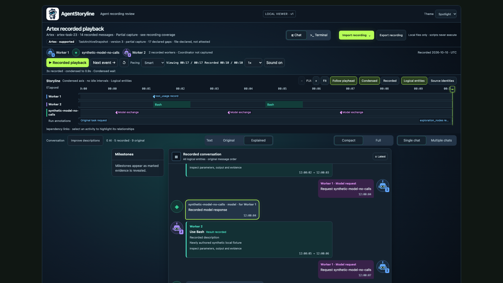
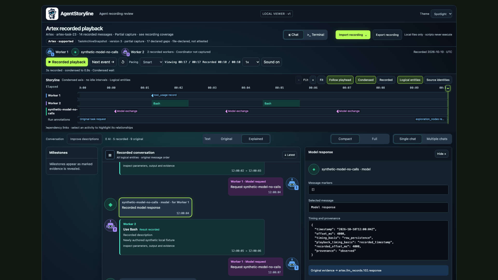

# AgentStoryline


AgentStoryline is a local-first agent-trace viewer: import a supported recording, follow its storyline and chat, inspect original evidence, and optionally improve descriptions. **v0.1 is a viewer release scope; playback never executes recorded commands or tools.** This repository remains a private development prototype. Release preparation does not authorize publication. Source agents and telemetry systems remain independent projects. See the [v0.1 release scope](docs/RELEASE_SCOPE_V0_1.md).





[Watch the current playback demo](docs/assets/agentstoryline-demo.mp4). The 34.7-second edited preview combines short title cards with a full-frame Spotlight playback from a retained Artex recording against an authorized isolated synthetic target. It shows the storyline and chat advancing through credential and token milestones, an exploitation attempt and protected-document retrieval. It does not expose the recorded credential or token value, and the source recording is not distributed. The supplied edit retains the project-generated notification tones from the reviewed source capture.

Python 3.10+ and the standard library are sufficient for the viewer. Native Artex `.tar.zst` imports additionally require an installed `zstd` executable; `.tar`, extracted exports, Codex rollout JSONL, OTLP JSON and experimental OrcaReplay ZIP/directory/plain tar imports do not. No model provider is required to import or play a recording.

`agentstoryline.py` is the preferred command. The compatibility entry point `traceforge.py`, existing `.traceforge.json` files, bundle schema identifiers and local saved-description state remain supported. Compatibility identifiers and original source evidence retain their existing names.

The prepared, unreleased application version is `0.1.0`:

```bash
python3 agentstoryline.py --version
```

See the [v0.1.0 release notes](docs/RELEASE_NOTES_V0_1.md), [changelog](CHANGELOG.md), [contribution guide](CONTRIBUTING.md), and [security policy](SECURITY.md). Maintainers can use the [release commands](docs/RELEASE_COMMANDS.md) and [publication checklist](docs/PUBLICATION_CHECKLIST.md) to prepare and review a deterministic source candidate.

## Try the synthetic viewer

```bash
python3 scripts/viewer_demo.py work/viewer-demo
python3 agentstoryline.py viewer work/viewer-demo/recording.traceforge.json --state-dir work/viewer-state
```

Open the local URL printed by `viewer`. The demo writes a normalized bundle, standalone HTML and portable `.traceforge.json` from newly authored synthetic Artex-shaped records. It starts no target or model service and executes no recorded commands. Open the generated HTML directly for offline viewing. Generated artifacts stay in ignored `work/`; choose a new demo output directory on subsequent runs.

## Open a recording

```bash
python3 agentstoryline.py viewer /path/to/recording.tar --state-dir work/viewer-state
```

The same command accepts `.tar.zst`, an extracted Artex export directory, a supported snapshot JSON, a Codex native rollout JSONL, canonical offline OTLP protobuf-JSON, a native OrcaReplay `.orca`/`.orca.zip`, trajectory directory or plain tar, or a portable recording:

```bash
python3 agentstoryline.py viewer /path/to/recording.traceforge.json --state-dir work/viewer-state
python3 agentstoryline.py viewer /path/to/codex-rollout.jsonl --state-dir work/viewer-state
python3 agentstoryline.py viewer /path/to/otlp-export.json --state-dir work/viewer-state
python3 agentstoryline.py viewer /path/to/orcareplay-trajectory.orca.zip --state-dir work/viewer-state
```

The loopback service detects supported native input, normalizes it and retains imported evidence under unique private state paths. It does not overwrite the source. In the served viewer, **Import recording** presents the Artex, Codex, OTLP, OrcaReplay and portable AgentStoryline choices before opening the local file picker; content detection remains authoritative. The standalone HTML viewer opens portable recordings, while native and telemetry import requires the local service. `explanation-serve` remains a compatibility command for existing portable recordings. Codex `exec --json` is a separate event stream and is reported as unsupported rather than misidentified as a native rollout. Unknown JSON is rejected instead of guessed to be Artex.

The viewer combines a storyline with animated chat or terminal messages, single/multiple chats, an evidence inspector and optional notification audio. Choose **Green**, **Spotlight** (the default), or **Dark** in the Theme menu. **Recorded playback reveals recorded messages; it never executes tools.** Smart pacing condenses waits for reading; Recorded pacing follows original elapsed timing. Neither changes evidence timestamps. Scrub by dragging the storyline playhead, and click a message or milestone to inspect its evidence.

The Artex adapter accepts TaskArchiveSnapshot formats 1–3, including exports from the authenticated, read-only `GET /api/tasks/{id}/recording-export` endpoint. Prefer that endpoint for active tasks; it does not invoke archive lifecycle changes. Historical exports remain partial when data was not captured. AgentStoryline does not need Artex installed to inspect them.

Native archives retain bounded transcript and workspace files with checksums. Transcript rows appear as recorded history, with evidence links under **Recording coverage → Source archive files**. The local viewer provides bounded text previews and explicit downloads for retained workspace/transcript files.

## Improve descriptions optionally

In the served viewer, choose **Improve descriptions**. Missing descriptions are selected by default. **Offline / Codex session** queues a bound local job for a worker in the existing session; AgentStoryline cannot awaken Codex automatically or run a local model. **API** uses an explicitly chosen provider endpoint, model and session key. Import and playback do not start generation.

Annotations are evidence-linked interpretations, stored separately with recoverable revisions. **Text → Original / Explained** chooses which text is displayed. Validation checks structure and citations; it does not establish factual correctness. Artex uses its dedicated profile; other sources use a conservative generic profile. See [description workflow and limits](docs/RELEASE_SCOPE_V0_1.md#optional-descriptions).

## Save portable copies

The top-level **Export recording** button downloads the currently loaded portable AgentStoryline JSON and is disabled until a recording is loaded. It includes current descriptions and attached scripts, but does not embed original archive/workspace bytes. Under **Improve descriptions → Optional details**, **Save enriched recording** exports the current annotations and **Download HTML** exports a standalone viewer. Standalone HTML supports offline review; generating or persistently saving new descriptions requires the local service. Exports preserve recorded content and are not automatically redacted.

Portable recordings are limited to 128 MiB and 5,000 rows in each event, message, actor, activity or lane collection; native-adapter limits do not guarantee that a recording fits the viewer. Portable JSON and HTML carry the source-file inventory and parsed history, but do not embed original workspace/transcript file bytes. Exact original-file downloads require the matching retained import in the same local state directory. Missing capture data and unavailable source files remain unavailable in an export. See [export boundaries](docs/RELEASE_SCOPE_V0_1.md#exports-and-original-evidence).

## Experimental sharing

The sharing implementation is experimental and its **Share recording** button is currently hidden. When enabled for development, it accepts custom terms and a **Preview** step. Review the redacted JSON and report, then check the review acknowledgment before downloading the derivative. The original recording stays unchanged. Attachments, original artifact references and audio are omitted by default. Redacted explanations are marked as derived.

Identifiers are retained for evidence links. Automatic redaction and custom terms do not guarantee removal of every sensitive value; inspect the derivative before sharing it. This workflow downloads a local file and does not publish or upload it.

## Source support and experimental modules

Artex archive import is supported; Codex native-rollout, offline OTLP protobuf-JSON and read-only OrcaReplay trajectory import are experimental. See the [source support matrix](docs/RELEASE_SCOPE_V0_1.md#source-support), [OTLP profile](docs/OTLP_ADAPTER.md) and [OrcaReplay adapter](docs/ORCAREPLAY_ADAPTER.md). AgentStoryline itself is source-neutral. Source labels describe declared provenance, not authenticated origin. Explicit `manifest.source.adapter` controls adapter selection; a legacy agent-name fallback applies only when that field is absent. An unknown explicit adapter uses the generic profile.

The common bundle remains schema `0.1` and the portable recording envelope remains version `1`. OTLP support is a pinned, offline protobuf-JSON profile with conservative GenAI mapping; it is not a live collector or a claim of universal OpenTelemetry compatibility. OrcaReplay native `.orca`/`.orca.zip` files are ZIP archives; plain tar is an additional import convenience. Imports retain manifest, event and referenced blob evidence, including recorded snapshot metadata and diffs; they do not restore a filesystem or Git state. LiteLLM and JEV-specific import or interpretation remain future work.

Procedural execution is outside v0.1. Existing replay and generated-workflow modules remain experimental development references, with their explicit authorization and local scope controls. See [replay contract](docs/REPLAY.md) and [generated workflow](docs/GENERATED_WORKFLOW.md). A recording format does not establish execution portability.

## Development and repository relationship

```bash
python3 -m unittest discover -s tests -v
```

`contracts/` describes recordings; `core/` validates them; `adapters/` translates source formats; `analysis/` handles interpretations; `web/` presents evidence and derivative sharing. Experimental `replay/` remains a separate execution boundary.

Original AgentStoryline code is licensed under Apache-2.0; see [LICENSE](LICENSE) and [third-party notices](THIRD_PARTY_NOTICES.md). Imported recordings and third-party assets retain their own rights. Preserve source notices and licenses. Real recordings, credentials and private research do not belong in Git or release artifacts. See [release validation](docs/RELEASE_VALIDATION.md) and the [public source audit](docs/PUBLIC_SOURCE_AUDIT.md) for readiness and packaging boundaries.
