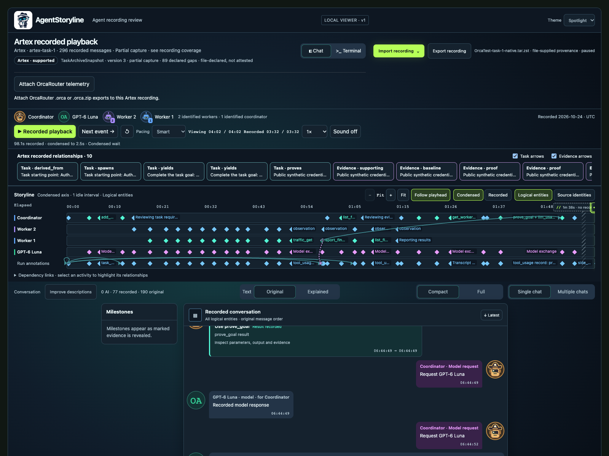
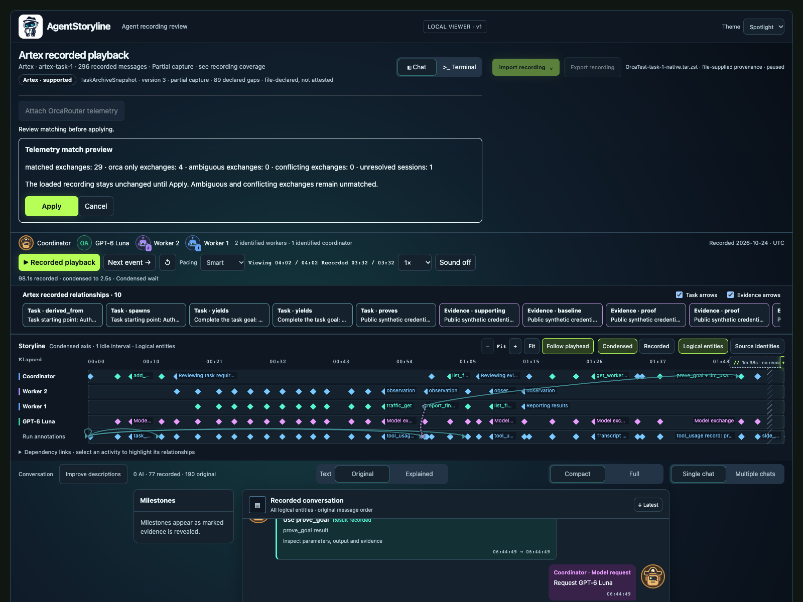
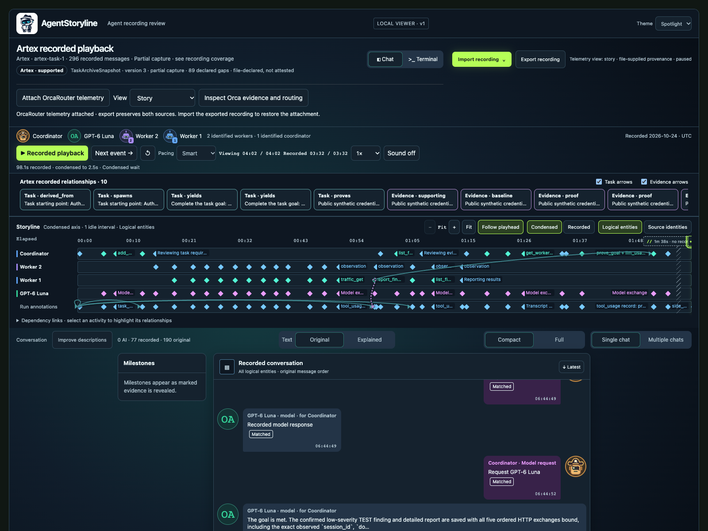
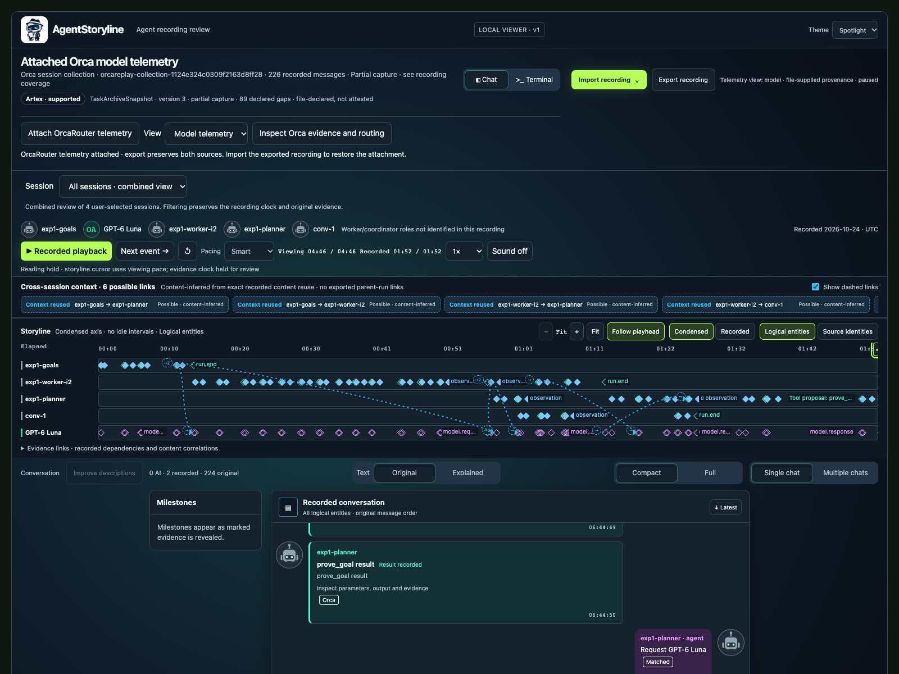
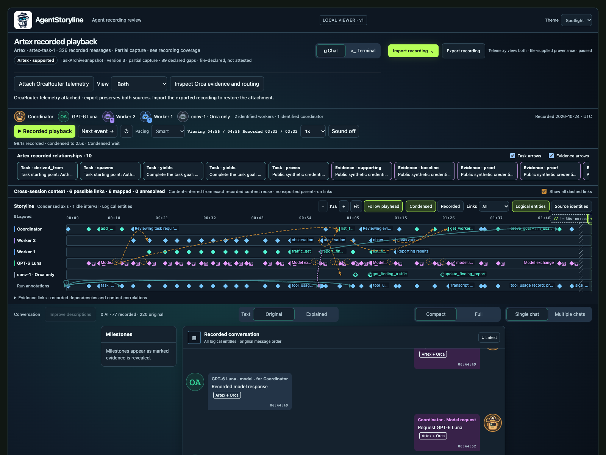

# Review an Artex run with optional Orca telemetry

Start with the Artex recording to follow the task, participants and recorded conversation. Optionally attach the OrcaRouter captures to inspect model exchanges, routing and additional sessions alongside that story. These views expose different capture boundaries; their labels do not promise equivalent completeness.

This walkthrough uses the [included OrcaTest 1 demo](../examples/orcatest-1/README.md). It is a sanitized real captured run against an authorized local synthetic fixture, not an invented transcript. All 602 Artex events are retained. The README playback video comes from a different retained recording; it is not a video of this demo.

## 1. Open the Artex recording

From the repository root, with Python 3.10+ and `zstd` installed:

```bash
python3 agentstoryline.py viewer examples/orcatest-1/artex/OrcaTest-task-1-native.tar.zst --state-dir work/orcatest-1-viewer
```

Open the loopback URL printed by the command. AgentStoryline imports a local copy and leaves the source archive unchanged. Import and recorded playback make no model calls, contact no target and execute no recorded tools.

To replace a recording in an already served viewer, choose **Import recording → Artex**, then select the same archive. Native import and telemetry attachment require this local service; opening standalone HTML alone is insufficient.



*The imported native Artex archive supplies the task story and original evidence before telemetry is attached.*

## 2. Optionally attach the four Orca files

Choose **Attach OrcaRouter telemetry**. In the file picker, select all four `.orca.zip` files in `examples/orcatest-1/orca/` together:

```text
run_36524fd8f6747fc2712506d0.orca.zip
run_5ec32a87c10ed8175272bfe3.orca.zip
run_78e32c79f75c04aba773d673.orca.zip
run_91e75b3261e20f42ca1f2f44.orca.zip
```

Review the **Telemetry match preview**, then choose **Apply**. Selecting files prepares the preview automatically; **Cancel** leaves the current recording intact. For these demo files, expect 29 matched exchanges, four Orca-only exchanges, zero ambiguous exchanges, zero conflicts and one unresolved session. The unresolved session is not an import error: its task membership has not been established, so the viewer does not invent that relationship. These counts describe matching, not complete capture coverage.



*Review the match counts before applying the optional attachment. The four files remain separately attributable sessions.*

## 3. Compare the three views

Use the **View** selector after applying the attachment.

| View | What to review |
| --- | --- |
| **Story** | The original Artex storyline, with matched Orca telemetry available in details. |
| **Model telemetry** | The complete attached Orca collection, including routing and sessions without an Artex match. |
| **Both** | The Artex story plus unmatched Orca model exchanges and explicitly linked tool proposals/results, with matched exchanges shown once. |



*Story keeps the native Artex task perspective. Select a message or activity to inspect evidence and any matched telemetry.*



*Model telemetry shows what the gateway captured across the selected sessions, including supplemental evidence that has no native Artex match.*



*Both deduplicates validated exchange matches while retaining source provenance. An **Artex + Orca** badge identifies a match between captures; it does not establish independent corroboration.*

## 4. Read evidence and links carefully

The native Artex archive records application task, participant and tool evidence. OrcaRouter records exchanges at the gateway boundary. Neither source fills every gap in the other. A model name, session label or nearby timestamp alone does not prove that two events match or that one session delegated to another.

Select messages, activities or relationship links to inspect their original evidence and matching basis. In **Both**, dashed amber cross-session links are **content-inferred** relationships from recorded content reuse. They remain distinct from native Artex relationships and recorded dependencies. They are review aids, not proof of causality or delegation. **Links: All / Artex / Telemetry** filters the visible relationship sources. Unresolved links remain inspectable with reasons instead of receiving guessed arrows or participant roles.

## 5. Keep the attachment for later

**Apply** saves the attachment in local viewer state; refreshing the browser retains it. **Export recording** saves a portable AgentStoryline JSON containing both normalized evidence bundles and the correlation map. Reopen that JSON to restore the combined review. Reopening the native Artex archive alone does not automatically attach the four Orca files again.

Portable JSON does not embed original archive/workspace bytes. Original-file downloads require the retained local import in the same state directory. Ordinary exports preserve recorded content and are not automatically sanitized. See the [attachment contract and limits](TELEMETRY_ATTACHMENTS.md) and [Orca collection evidence boundaries](ORCA_COLLECTIONS.md).
